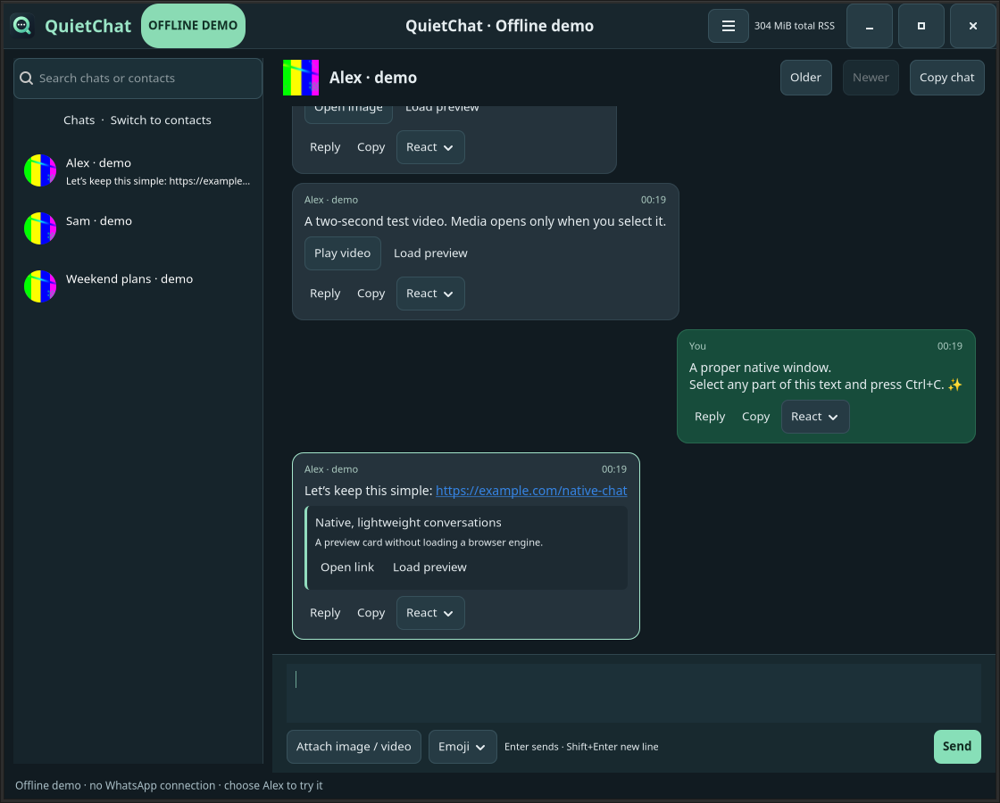
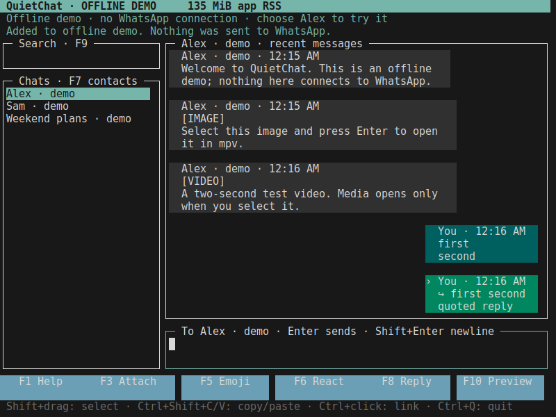

<div align="center">


# QuietChat

**Your chats, without an embedded browser.**

A native Linux WhatsApp companion with a GTK4 desktop interface and a terminal UI.
Part of [Quiet](https://github.com/quiet-desktop-apps) · [MIT](LICENSE)
</div>



*Real application screenshot, offline demo data. No private messages or accounts.*

## Why QuietChat?

A focused messaging app should not need its own Chromium instance. QuietChat keeps
text, images, video, replies and reactions in a native interface, with bounded
history pages and media loaded on demand. It does not try to reproduce every
WhatsApp feature. The service connection still needs memory: removing Chromium
is a design choice, not a promise of a fixed RAM ceiling.

During development, one live snapshot measured about **244 MiB combined app RSS**
for QuietChat's GTK UI, backend and small helpers, versus **1,536 MiB** for the
Chromium-based WhatsApp client used on the same workstation—about **84% less**.
This was an observational snapshot, not a controlled universal benchmark. The
terminal version has been observed around **170 MiB app RSS** in everyday use.
See [memory evidence and measurement scope](docs/memory.md) before comparing figures.

## Desktop and terminal

| Capability | GTK4 desktop | Terminal |
|---|---|---|
| QR pairing and saved login | Yes | Yes |
| Text, images/videos, replies, reactions | Yes | Yes |
| Enter sends; Shift+Enter adds a line | Yes | Yes, terminal support required |
| Image/video viewing | Small inline previews; mpv on demand | External mpv window on demand |
| Mouse text selection and clipboard images | Native selection; paste image attachment | Terminal selection; file attachments |
| System tray, unread badge, desktop notifications | Yes, desktop support required | **No built-in desktop notifications or tray** |

The terminal UI is useful when you want fewer desktop components. Its major
limitation is **notifications**: keep it open to watch incoming messages. It is a
terminal interface, but media playback still opens a graphical viewer.



## Install from source on Linux

Requires Node.js **22.16+** with npm, system Python **3.11+**, GTK4 **4.8+**,
PyGObject, GdkPixbuf, mpv and ffmpeg. Ubuntu/Debian system packages:

```bash
sudo apt install python3 python3-gi gir1.2-gtk-4.0 gir1.2-gdkpixbuf-2.0 mpv ffmpeg
# Install Node.js 22.16+ and npm using your preferred supported method.
git clone https://github.com/quiet-desktop-apps/QuietChat.git
cd QuietChat
npm ci
./launch.sh --demo        # Try it offline first
./launch.sh               # Open the native app and pair your phone
python3 scripts/install_desktop.py
```

The installer adds a user-local command and Applications entry linked to this
checkout. Keep the checkout in place. Add `~/.local/bin` to PATH if needed:

```bash
export PATH="$HOME/.local/bin:$PATH"
quietchat                  # GTK4 desktop
quietchat --terminal       # Terminal UI (Alacritty supported)
quietchat --version
```

Quit with **Ctrl+Q** before switching interfaces; closing the GTK window can leave
it running in the tray. Both interfaces share the same saved session and database,
so switching does not require pairing again. The first login uses
**WhatsApp → Linked devices → Link a device** on your phone to scan the QR code.

Desktop features include circular contact photos, clickable links, optional URL
previews, clipboard image attachments, per-chat drafts, quoted replies and unread
badges. Read the [user guide](docs/usage.md) and [terminal guide](docs/terminal.md).
There are no signed binary packages or automatic updates yet. To update a clean
source checkout, pull `master`, run `npm ci`, then fully quit and reopen the app.

## Architecture and engineering

Python/GTK4 renders native widgets. A TypeScript/Node.js process uses Baileys for
WhatsApp, SQLite for local state, and a bounded JSON-lines protocol to communicate
with the UI. The terminal frontend reuses those backend modules. Media opens in
mpv; thumbnails use ffmpeg. **There is no Chromium, Electron or embedded webview.**

[Architecture](docs/architecture.md) · [Agentic Engineering](docs/agentic-engineering.md)
· [Decisions](docs/decisions/0001-native-clients.md) · [Verification](docs/verification.md)

Humans own the idea, high-level requirements and important technical decisions.
Agents implement, test and document within that direction. Changes reach `master`
through PRs and required checks; the human maintainer owns acceptance and merge
authority.

## Development

```bash
npm ci
npm test
npm run test:terminal
# Native tests also need xvfb, xauth, dbus-x11, x11-xkb-utils and libxtst6.
npm run test:native
```

Automated tests use synthetic accounts and temporary data. They do not send real
WhatsApp messages. The Wayland/IBus accent regression is a separate desktop check;
see the verification record. Contributions, bug reports and measured improvements
are welcome: [contribution guide](CONTRIBUTING.md), [security reporting](SECURITY.md).

## Privacy, compatibility and license

QuietChat is **unofficial**, not affiliated with or endorsed by WhatsApp or Meta.
It uses the unofficial Baileys protocol library; upstream changes and account
restrictions can affect use. Calls, full service parity and comprehensive delivery
indicators are outside the current scope.

Saved login keys and messages live locally under your XDG data directory, normally
`~/.local/share/quietchat`. File permissions restrict access, but the database is
not encrypted at rest. Never publish it or a pairing QR code. No Quiet-hosted
service is required. See [architecture](docs/architecture.md) for network boundaries.

Original QuietChat code and bundled original assets are [MIT licensed](LICENSE).
Dependencies retain their own licenses: [third-party notices](THIRD_PARTY_NOTICES.md).
Maintained by [Paulo Aboim Pinto](https://github.com/aboimpinto).
