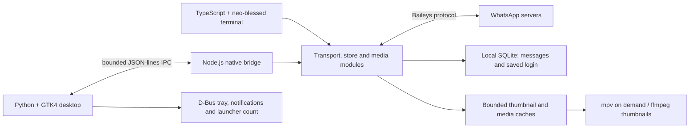

# QuietChat architecture

QuietChat is a native Python/GTK4 desktop UI plus a reusable TypeScript backend.
The earlier terminal UI remains a first-class launch option. Neither embeds a
browser. The choice is recorded in [ADR 0001](decisions/0001-native-clients.md).

## Components and ownership

| Component | Responsibility |
|---|---|
| `native/app.py` | GTK widgets, current message page, drafts, actions, clipboard and view lifecycle |
| `native/bridge.py` | Child process, bounded result queue and main-loop callback delivery |
| `native/desktop_services.py` | StatusNotifierItem, notifications, unread reconciliation and launcher counts |
| `native/clipboard_images.py` | Async image encoding and private temporary attachment lifetime |
| `native/input_method.py` | Process-local Wayland/IBus selection; preserve explicit user choices |
| `src/native-bridge.ts` | Typed backend operations over JSON lines; revisions for unread snapshots |
| `src/transport.ts` | Baileys connection, QR lifecycle, sends and incoming events |
| `src/store.ts`, `src/auth.ts` | SQLite message/contact state, retention and saved authentication |
| `src/media.ts`, `src/native-assets.ts` | File validation, download, previews and cache limits |
| `src/ui.ts`, `src/terminal-*.ts` | Terminal widgets, keyboard handling and Unicode-width adaptation |

UI events and backend completions are explicit. Generation/revision checks discard
stale results after chat switches, reconnects or read-state changes. A send remains
pending until its backend reply; silence or elapsed time is not success. This does
not imply recipient delivery or read receipts.

## Resource lifetime

Only one 60-message page owns GTK message widgets. Changing chats or hiding to the
tray destroys that page's widgets and decoded images. Sidebar queries return up to
200 chats; only visible avatars are requested, with 64 tiny decoded photos cached.
Thumbnails are bounded to 12 automatic previews per page and two workers. Backend
history retains up to 10,000 messages. Preview disk cache is 200 files / 16 MiB;
media disk cache is 256 MiB, with 100 MiB per attachment. Clipboard drafts have
separate 32-megapixel, 100 MiB/image and 256 MiB combined limits.

The bridge uses a 128-item queue and processes at most 32 callbacks per GTK tick.
Per-chat drafts persist in memory until sent/cleared/quit; they are a deliberate
retention exception, not a claim that every inactive chat uses zero RAM. Allocators
can retain freed pages. Hiding the window keeps the connection and notifications
alive. Fully quitting stops the backend and cleans temporary clipboard images.

## Privacy and service boundaries

Local state is under `$XDG_DATA_HOME/quietchat` or `~/.local/share/quietchat`.
The SQLite database includes login keys and message data and is not encrypted at
rest; private file/directory permissions are the local protection. Authentication
is never committed or bundled. One instance owns a data directory at a time.

Baileys connects to WhatsApp's service infrastructure. Avatars and media download
on demand; public URL previews are fetched only on request, with time/size limits,
and never execute website code. The user's browser handles clicked links.
There is no Quiet-operated account server or analytics backend. Dependencies and
service providers still have their own behaviour and terms.

System notifications can reveal sender names, excerpts and avatars to the local
desktop. Users can disable notifications in the menu. Read-state revisions clear
badges and the app's own notifications without clearing other apps' messages.

## Frontend differences and verification

The terminal frontend shares pairing, transport and storage. It does not implement
the native tray or desktop notification service. Images/videos open in mpv instead
of inline terminal rendering. Quit one frontend before starting the other.

Tests cover typed operations, fake protocol events, storage, media fixtures,
physical terminal/GTK keyboard input, clipboard, D-Bus notification races and
bounded switching. These tests do not certify WhatsApp interoperability or account
safety. See [verification](verification.md) and [memory](memory.md).
