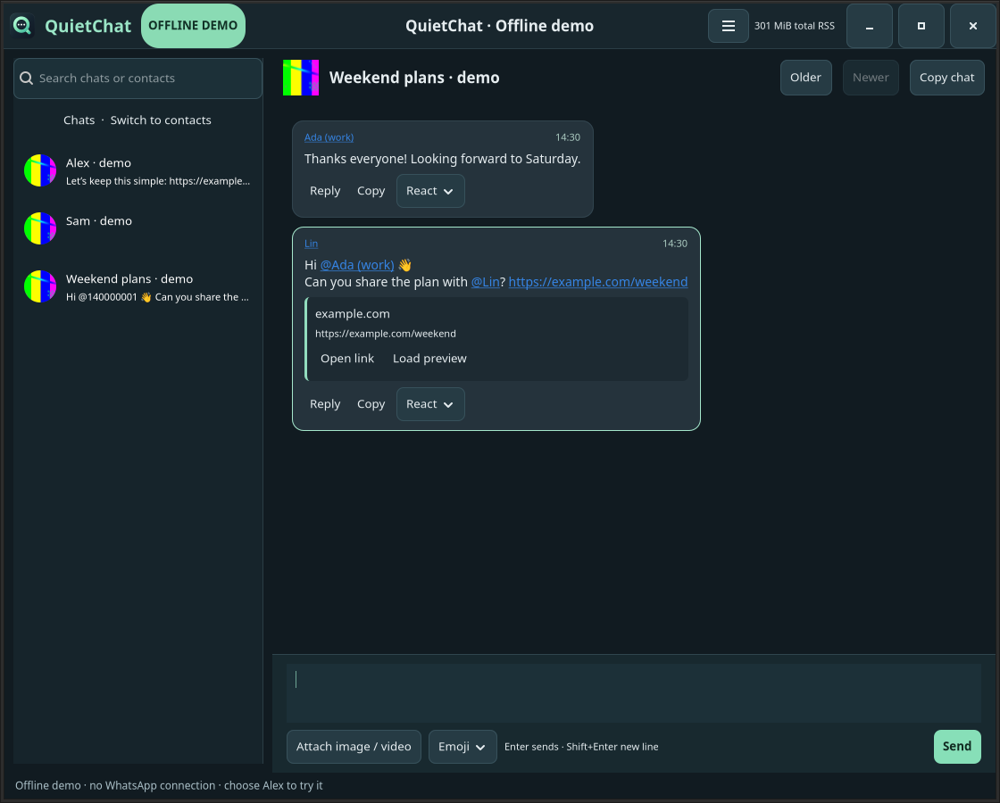

# QuietChat

A native Linux WhatsApp companion using **Python + GTK4**, with the existing
TypeScript/Node.js WhatsApp connection and SQLite store. No Chromium or webview.
The original terminal interface remains available.

## Start

```bash
quietchat                       # Native GTK4 window
quietchat start                 # Same window
quietchat --demo                # Offline demo; no account or real messages
quietchat --terminal            # Original terminal interface in Alacritty
quietchat --background          # Start hidden when a tray host is available
quietchat --version             # Version and source checkout
```

After installation, the **QuietChat icon in Applications** opens this native version.
The command, desktop entry and icons link directly to this checkout. Every launch
builds its TypeScript backend; Python loads from the same source. Restart after
source changes. Version 0.2.0 switches the default UI; it does not replace your
saved login or chat database. Quit the old terminal instance before starting the
native app, since the account has a single-instance lock.

From the repository root, use `./launch.sh`. Install the
user-local command and desktop entry with:

```bash
python3 scripts/install_desktop.py
```

Runtime dependencies: Node.js 22.16+, npm, system Python 3, `python3-gi`,
`gir1.2-gtk-4.0`, `gir1.2-gdkpixbuf-2.0`, `mpv`, and `ffmpeg`. GTK4 renders native
widgets; the default renderer is Cairo. The desktop session provides D-Bus.

## Pairing and saved login

On first use the native window displays a refreshing QR code. On your phone,
open **WhatsApp → Linked devices → Link a device**, then scan it. The QR clears
after connection. Later launches reuse the existing saved session and messages.
Pairing state lives under `~/.local/share/quietchat` (or XDG_DATA_HOME/quietchat);
`--data-dir DIRECTORY` selects a separate private state directory.

The application uses the pinned Baileys library, an unofficial WhatsApp client.
Protocol changes can affect connectivity. Account-linked sending and actual
notification behavior should be checked on your phone after upgrading; automated
tests use synthetic accounts and never message your contacts.

## Messages and controls

- Chat/contact rows show small circular profile photos, with initials when no photo
  is available. Photos load as rows become visible; the in-memory avatar cache holds
  decoded photos for visible rows; offscreen photos remain cached on disk.
- Group messages show your saved contact name first, then the person's available
  WhatsApp profile name. A group title is never used as a participant's name.
  If no name has synced, the identifier remains visible; missing sender metadata
  displays “Unknown participant.” Names update as contact/profile data arrives.
- Click a sender's name or an **@mention** in the desktop UI to open a direct chat.
  Opening it does not send anything; your group draft is preserved. Existing direct
  chats are reused when WhatsApp has supplied the person's linked identifiers.
  Both desktop and terminal resolve declared mentions in text and media captions;
  ordinary @numbers and URLs are not guessed to be contacts.
- Incoming messages align left; yours align right. Explicit newlines remain intact.
- **Drag over message text, then Ctrl+C**. **Ctrl+V** pastes into the composer or
  another application. Ctrl+Shift+C/V also work. Pasting never sends a message.
- **Ctrl+V with a screenshot or copied image** prepares an image attachment with a
  small thumbnail. Add an optional caption and press Enter or click Send when ready.
  Ctrl+Shift+V also works. Pasting never sends automatically; the × removes the image.
  Image drafts stay with their chat when switching conversations.
- **Enter sends**, **Shift+Enter inserts a newline**. Ctrl+S also sends.
  While composing an accented character, Enter first lets the input method finish
  the character. Press Enter again to send the completed message.
  On Wayland sessions configured for IBus, QuietChat uses IBus directly for accent
  keys such as ´ followed by a → á. Explicit input-method overrides are respected;
  this does not change your desktop keyboard settings.
- Click a link to open it in your regular browser. URL cards show metadata already
  in the message; **Load preview** fetches a bounded preview on demand.
- **Reply** or **F8** quotes the selected message. Escape cancels the quote while
  retaining the draft. Draft text, attachment and reply target stay with each chat.
- **Copy** copies one message; **Copy chat** copies all messages on the current
  page, including sender names and timestamps. Use Older/Newer for other pages.
- Attach images/videos with the file picker (**F3**) or enter a path (**F4**).
  Text becomes the attachment caption. Preview checks an attachment before sending.
- **Emoji / F5** inserts an emoji into the message or caption. **React / F6** adds
  or removes a reaction. **F10** opens selected media or previews the attachment.
- **F7** switches chats/contacts, **F9** focuses search, **F1** shows help.

Small images and video thumbnails appear inline. **Open image / Play video** uses
mpv on demand; closing the viewer releases its memory. No permanent selected-media
information panel is shown. Contact names and group participant names use the same
resolution as the terminal version.

## Tray and notifications

Closing the window keeps the account connected in the system tray when available.
A red tray badge shows 1–99 unread messages, then **+99** for larger counts; it
disappears at zero. The Ubuntu dock receives the actual unread count through its
launcher API. Dock badge colour and number formatting follow the desktop theme
and cannot be set per app through that API. System notifications show
the sender, message excerpt and avatar when WhatsApp makes the avatar available.
Click a notification to open its conversation. Reading the latest page clears the
local unread badge and dismisses that chat’s desktop notifications. Read-state
updates also reconcile other chats, including reads synchronized by WhatsApp.
Notification IDs are stored privately with the notification service identity, so
owned notifications can be cleared after app restart without touching other apps.
Old history, duplicate events and your own messages do not
create popups. The active conversation does not notify while the window is focused.

Use the tray/menu **Quit QuietChat** or **Ctrl+Q** to stop completely. The menu lets
you disable notifications, background operation or thumbnails. Preferences persist.
If no tray host exists, closing quits; if the tray disappears, the window reopens.
This does not configure automatic login startup. Ubuntu tray and notification
services were detected on the development machine.

When upgrading from 0.2.2 or older, dismiss any old QuietChat notifications once
from Ubuntu’s notification panel if their count remains. Those versions did not
retain notification IDs, and the desktop API cannot list them for recovery. New
notifications are dismissed automatically when read; no global theme is changed.

## Memory and storage

The header reports **combined GTK UI + WhatsApp backend RSS**, with separate values
in its tooltip. This excludes mpv/ffmpeg and includes shared library pages in each
process's RSS. See [verification](verification.md) for measured offline results;
live-account synchronization can use more memory.

Only the current 60-message page has GTK message widgets. Switching chats or hiding
the window releases those widgets and images. The sidebar loads at most 200 entries
per search; messages remain on disk with 10,000-message retention. Drafts are kept
until sent or cleared. Thumbnails use two concurrent workers and at most 12 automatic
previews per page, scaled to 480×320 pixels. Preview/avatar disk cache is capped at
200 files / 16 MiB; downloaded media at 256 MiB, with 100 MiB per attachment.
Clipboard images are encoded as private temporary PNG files, with a 32-megapixel
image limit and a 256 MiB combined clipboard-draft limit. Encoding runs outside the
GTK input loop; only a small preview remains in the UI. Temporary files are removed
after a successful send, replacement, removal or full app exit; failed sends keep
the attachment for retry.
Public HTTPS website previews have an eight-second / 512 KiB response limit and
never embed or execute website content. Image links are fetched only for an explicitly
requested preview. Avatars and message-embedded thumbnails load automatically.

## Development and verification

```bash
cd QuietChat
npm test
npm run test:terminal
npm run test:native              # Requires Xvfb, X11/XTest and session D-Bus
```

Native code is under `native/`; `src/native-bridge.ts` provides typed-backend
operations through bounded JSON-lines IPC. The CLI and GTK frontend share transport,
authentication, media handling and SQLite rather than running two account sessions.
The [terminal guide](terminal.md) retains the earlier terminal-specific details.

## Group example

This offline example uses synthetic people: **Ada (work)** is a saved contact,
while **Lin** is known only by the profile name. Mentions use those same names.



## Disk cache and tray memory

Closing to the tray clears message and contact-list widgets, decoded photos and
previews from the window. Cached image files remain on disk, so reopening can use
them again. Text, reply and image-attachment drafts remain available; the WhatsApp
connection, unread indicators and notifications stay active. Offscreen sidebar
photos also leave the decoded-image cache when you scroll. The runtime may retain
some RAM for reuse, so hiding is not a guarantee of a particular memory number.
